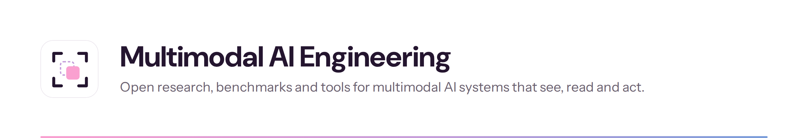
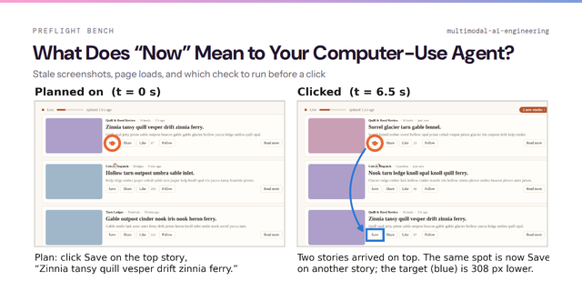

<picture>
  <source media="(prefers-color-scheme: dark)" srcset="assets/org-banner-dark.png">
  
</picture>

Every project here ships with its code, its data and its full results, including the hypotheses that did not hold.

## Research

<table>
  <tr>
    <td width="44%" valign="top">
      
    </td>
    <td valign="top">
      <b><a href="https://github.com/multimodal-ai-engineering/preflight-bench">What Does “Now” Mean to Your Computer-Use Agent?</a></b> 
      Stale screenshots, page loads, and which check to run before a click · 2026
      
Computer-use agents act on screenshots that go stale mostly in the first second after a page opens, and a one-second wait prevents most of it. Where a check is still needed, pixels verify where the target is and a small model verifies what happened.

      <a href="https://github.com/multimodal-ai-engineering/preflight-bench">Code and benchmark</a>
    </td>
  </tr>
</table>

## Talks

**What Does “Now” Mean to Your Model?** · [Reverie Summit](https://www.reveriesummit.com), San Francisco, November 5, 2026 
From learning to act from video to acting on a screen that moved.

## Book

**[Data Engineering for Multimodal AI](https://www.oreilly.com/library/view/-/9781098190774/)** · O'Reilly, 2026

 

Maintained by Vasundra Srinivasan. Independent research, not affiliated with or endorsed by any employer.
